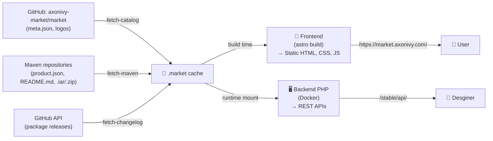

# 🛍️ market.axonivy.com

[](https://hosted.weblate.org/engage/axonivy/)


Static Axon Ivy Market website, built with [Astro](https://astro.build) and React. All code lives in [`frontend/`](frontend).

## Prerequisites

- [Node.js](https://nodejs.org) 22.18 or newer
- [pnpm](https://pnpm.io/installation), e.g. `npm install -g pnpm`

## 🚀️ Getting started

```sh
cd frontend
pnpm install
pnpm fetch-data   # download market data into .market/ (needed once, and to refresh)
pnpm dev          # http://localhost:4321
```

### ✍️ Changelogs (optional)

Changelogs are fetched from GitHub releases and need a [GitHub token](https://github.com/settings/tokens) (no scopes needed). Put it in `frontend/.env.local`:

```sh
GITHUB_TOKEN=<your-token>
```

Then run `pnpm fetch-changelog`.

### meta.json types

The types for the products' `meta.json` are generated from the [market schema](https://github.com/axonivy-market/market/blob/master/schema/meta.json) into `frontend/scripts/generated/meta.ts`. Don't edit that file by hand; regenerate it after a schema change:

```sh
pnpm generate:meta
pnpm typecheck
```

The pipeline does the same on every build, so a schema change that breaks the site fails the build.

### 🌐️ Integrated local website

To build the frontend and serve it together with the PHP API through Apache, run from the repository root:

```sh
./dev.sh
```

Open <http://localhost/>. The API is available at `/stable/api/*` and the OpenAPI contract at `/stable/openapi.json`. Stop Apache with `docker compose -f backend/compose.yaml down`.


## 💾️ Caching

The public website and backend API both consume a unified cache created at build time.  
The cache contains product metadata, maven product installers, and changelogs.


